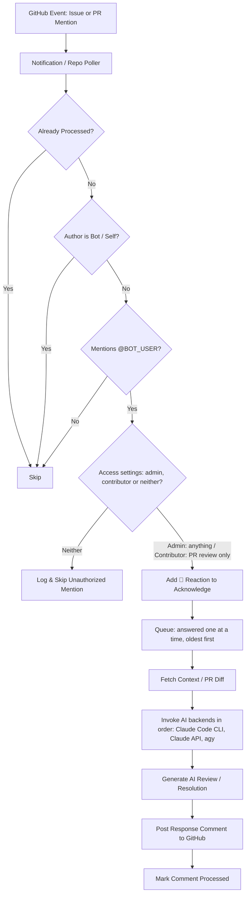

# GitHub AI Review & Assistant Agent

An autonomous GitHub review and coding assistant agent powered by Claude (through the Claude Code CLI or the Claude API) or Google Antigravity CLI (`agy`). The bot continuously monitors GitHub notifications and repository comments, reviews pull request diffs, answers issues, executes code modifications, and responds directly on GitHub threads.

**Quick start:** run `./setup.sh`. It stops the service, lets you pick the backend and the default model, tests them on the spot, and redeploys the service when you type `done`. To use a different model for one reply, put `--model` in your comment (see [Choosing the model from a comment](#choosing-the-model-from-a-comment)). Who may ask the bot, and the models each of them gets, are set on the dashboard's settings page (see [Who Can Ask the Bot](#who-can-ask-the-bot)).

---

## Architecture & Workflow



---

## Features

- **Automated Code Reviews & Assistance**: Uses Claude or Antigravity CLI (`agy`) to inspect diffs, test builds, review pull requests, and explain complex code logic.
- **Backend & Model Fallback**: Tries each backend in `AI_BACKENDS`, and each of its models, until one replies, so a used-up plan or API quota doesn't stop the bot.
- **Per-Comment Model Choice**: Admins can pick the model and effort for a single reply from the comment itself.
- **Code Checkout**: Each reply gets a throwaway checkout of the repository at the PR's head commit, so the CLI backends can read the changed files in full, their callers and the tests, not just the diff.
- **CI Instead of Local Builds**: The bot reads the PR's CI results rather than building or testing locally, and never uses or installs Nix.
- **Immediate Acknowledgment**: Reacts to mentions with the `eyes` (👀) reaction as soon as they are queued, so authors know their request was received.
- **Queue**: Mentions are answered one at a time, oldest first. The ones waiting their turn show as Queued on the activity dashboard, with their place in line.
- **Access Control, Set on the Dashboard**:
  - **Admins** (`ADMIN_USER` and anyone you add) can ask for anything, in any repo.
  - **Contributors** can ask for a review of a pull request, and nothing else, in the repos you open to them: to anyone, or only to the people you list. Their reviews run with read-only tools, their own models and a daily limit.
  - **Loop Prevention**: Automatically ignores bots (such as CI/CD bots, Vercel bot, or self).
- **Dual Polling Engine**: Monitors GitHub unread notifications as well as active repository comment feeds (`WATCH_REPOS`).
- **Identity Isolation**: Commits and responses are strictly signed and authored by the bot identity, preserving maintainer credentials.
- **Secure by Design**: All tokens and identities are strictly decoupled into `.env` and excluded from version control.

---

## Prerequisites

Ensure the following dependencies are installed on the host running the agent:

1. **At least one AI backend**:
   - **Claude Code CLI** (`claude-cli` backend), logged in with a Claude subscription:
     ```bash
     curl -fsSL https://claude.ai/install.sh | bash
     claude auth login
     ```
   - **A Claude API key** (`claude-api` backend), from https://platform.claude.com/settings/keys
   - **Antigravity CLI** (`agy` backend):
     ```bash
     agy --version
     ```
2. **GitHub CLI (`gh`)**:
   ```bash
   gh --version
   ```
3. **Utilities (`jq`, `curl`, `git`)**:
   ```bash
   sudo apt update && sudo apt install -y jq curl git
   ```

---

## Installation & Setup

### 1. Clone the Repository

```bash
git clone https://github.com/<your-username>/github-review-agent.git
cd github-review-agent
```

### 2. Configure Environment Variables

Create your `.env` configuration file from the provided example:

```bash
cp .env.example .env
```

Edit `.env` with your preferred editor and fill in your details:

```bash
nano .env
```

### 3. Secure File Permissions (CRITICAL)

Restrict file permissions so only your local user can read or modify the `.env` file:

```bash
chmod 600 .env
```

> [!WARNING]
> Never commit your `.env` file or paste raw tokens into scripts. The repository `.gitignore` automatically excludes `.env`, but always verify with `git status` before pushing commits.

### 4. Choose the AI Backend and Model with `setup.sh`

Run the setup script whenever you want to switch backends, change the default model, or add an API key:

```bash
./setup.sh
```

It walks through these steps:

1. Stops `review-agent.service`.
2. Checks the GitHub token, and asks for the GitHub settings if `.env` doesn't have them yet.
3. Asks which backend to use: Claude Code CLI, Claude API, either one with the other as a fallback, or Antigravity CLI.
4. For each backend:
   - **Claude Code CLI**: shows which account and plan `claude` is logged in with.
   - **Claude API**: asks for the API key (hidden). Press Enter to keep the saved one.
   - Lists the available models, so you can pick the default and its fallbacks.
   - Sends each model a short test prompt and shows whether it worked, with the reason if it didn't.
   - **Claude API**: also shows your rate-limit headroom. Give it an Admin API key (`sk-ant-admin...`, not saved) and it also shows this month's spend. The API doesn't report the remaining credit balance; see https://platform.claude.com/settings/billing for that.
5. Shows a summary. Type `done` to save the settings to `.env` (the previous file is kept as `.env.bak`) and redeploy the service.

If you quit early or press Ctrl+C, nothing is saved and the service starts again with its previous settings.

---

## How the Bot Sees the Code

For every reply, the bot checks out the repository in a throwaway worktree:

- **For a PR:** the PR's head commit, with the base branch available as `origin/<base>`.
- **For an issue:** the default branch.

The Claude Code CLI (and `agy`) run inside that worktree, so they can open the changed files in full, follow callers and read the tests. The worktree is deleted after the reply. The bare clone stays in `data/repos/<owner>/<repo>.git`, so later replies only fetch what changed.

**No local builds or tests.** The machine has limited storage, so the bot doesn't compile, build, install dependencies, or run tests and linters. It relies on the PR's CI instead: a summary of the PR's checks (for example `14 passed, 1 failed (Verify / Lint)`) goes into every prompt, and the bot can read failing logs with `gh run view --log-failed`. It runs tests only when your comment explicitly asks:

```text
@your-bot-username run the unit tests for the changed package and tell me if they pass
```

**No Nix, ever.** `claude` runs with deny rules for `nix`, `nix-shell`, `nix-build`, `nix-env` and the other Nix commands, plus `direnv` and `sudo`. These are enforced even with `--dangerously-skip-permissions`, so not even a comment can make the bot install or use Nix. `agy` has no such switch and is only told not to.

Because a PR's contents are untrusted, `claude` also runs with `--setting-sources user --strict-mcp-config`. That way a `.claude/settings.json` or `.mcp.json` added in a PR can't run hooks or start servers on the machine. The Claude API backend runs no tools, so it works from the diff and the CI summary in the prompt.

Set `PR_CHECKOUT=false` to review from the diff alone.

---

## How Mentions Are Queued

The bot answers one mention at a time, oldest first. Each poll finds every new mention, queues the ones it should answer and reacts to each with 👀 straight away, so you know it was seen even when other replies are ahead of it. After each reply the bot polls again before taking the next mention, so anything posted in the meantime joins the end of the queue.

On the [activity dashboard](#activity-dashboard), mentions waiting their turn are listed at the top as **Queued**, with their place in line ("next in line", "2nd in line"), and the header shows how many are waiting. A queued mention becomes a normal running record when its turn comes.

A mention's notification stays unread until its reply is posted. If the agent restarts with mentions still queued, it drops their queued records and finds the mentions again on its first poll, so none are lost.

---

## Who Can Ask the Bot

The bot answers two kinds of people, set on the dashboard's **Settings** page. Everyone else who mentions it is ignored.

| | Admins | Contributors |
| :--- | :--- | :--- |
| Who | `ADMIN_USER`, always, and anyone you add | In each repo you open to contributors: anyone, or only the people you list |
| Where | Any repo | Only those repos, and only on pull requests |
| What | Anything: reviews, answers, code changes, pull requests | A review of the pull request, whatever the comment asks |
| Tools | All of them (see [How the Bot Sees the Code](#how-the-bot-sees-the-code)) | Read and search the PR's checkout, nothing else |
| Models | The admins' default and fallback, or `--model` / `--effort` in the comment | The contributors' default and fallback |

The page also sets each group's Claude models and effort, and how many reviews one contributor can get in 24 hours (0 for no limit). Saved changes apply from the next mention, with no restart.

**What a contributor gets.** On a pull request, the bot writes a review in the usual format, using the comment only as a hint about what to focus on. If the comment asks for something else, the bot doesn't do it, and says that it only reviews pull requests for contributors. On an issue, it replies that it only reviews pull requests. Past the daily limit, it replies that they should ask again later. These replies don't use a model.

**How contributor reviews are limited.** A comment from someone outside the project is untrusted, so the limits are enforced by the tools, not just the prompt:

- `claude` runs with `--restricted --tools Read,Grep,Glob`. It can read and search files but has no tool that runs commands or fetches URLs, file reads can't leave the PR's checkout (symlinks included), and no settings file is loaded. With no checkout, it runs in an empty directory.
- It gets no GitHub token, so it can't post, push or open anything. The agent posts the review.
- `agy` can't be restricted this way, so it never answers a contributor. `claude-api` has no tools at all.

**Where the settings live.** `data/access.json` (`ACCESS_FILE`). The agent writes it on its first start, with `ADMIN_USER` as the only admin, the admins' models from `CLAUDE_MODELS` and `CLAUDE_EFFORT`, and no repo open to contributors. After that, the file's models are the ones used, for both Claude backends; `./setup.sh` writes the admin models you pick there too. The page saves the file through a small settings API, `settings-server.mjs` (Node, no dependencies), which checks every change before it writes it. It runs as `review-agent-settings.service` on `127.0.0.1:9098`, and `./setup.sh` installs and restarts it along with the agent. To serve it on the dashboard, add this to the dashboard's nginx `server` block, inside the password-protected part (see [Activity Dashboard](#activity-dashboard)):

```nginx
location /api/ {
    proxy_pass http://127.0.0.1:9098;
    proxy_set_header X-Forwarded-Host $host;
    proxy_set_header X-Remote-User $remote_user;
    client_max_body_size 64k;
}
```

The API only accepts changes sent from the dashboard page itself, and records which dashboard user saved them.

---

## Activity Dashboard

Every reply is recorded so you can see exactly what the bot did:

- the comment and its context (CI results, the checked-out commit)
- the prompt sent to the model
- each attempt, backend by backend and model by model, with its thinking summaries, every tool call (commands, files read, searches) and their output
- the final result with turns, tokens and the equivalent API cost
- the reply that was posted

Each record also says whether the mention came from an admin or a contributor. A record is written as soon as a mention is queued and updated while the bot works, so mentions waiting their turn are listed and a reply in progress can be watched live. GitHub tokens and API keys are scrubbed before anything is written, and records older than `RUNS_KEEP_DAYS` (7 by default) are deleted.

Models never return their raw reasoning, only a readable summary of it, so the thinking shown is that summary. Showing summaries costs no extra tokens: the model thinks, and is billed, the same either way.

**Layout.** Records go under `$DASHBOARD_DIR/runs/<id>/`, with `meta.json`, `prompt.txt`, `attempt-<n>.jsonl` (`.txt` for `agy`) and `reply.md`. `runs/index.json` lists them all. The viewer in `web/` is copied into `$DASHBOARD_DIR` each time the agent starts. It's static pages with no third-party scripts, so any web server can host it. Only the settings page needs a server, the settings API (see [Who Can Ask the Bot](#who-can-ask-the-bot)).

**Hosting it with nginx.** Point `DASHBOARD_DIR` at a folder nginx can read, such as `/srv/review-agent`, owned by the agent's user with group `www-data` and mode `2750`. Serve it with password protection, since records contain code and comments from private repositories. The unit file already lets the service write to `/srv/review-agent`.

```nginx
server {
    listen 443 ssl;
    server_name review.example.com;
    root /srv/review-agent;
    auth_basic "Review agent";
    auth_basic_user_file /etc/nginx/review-agent.htpasswd;
    location /runs/ { expires -1; }
    location /api/ {
        proxy_pass http://127.0.0.1:9098;
        proxy_set_header X-Forwarded-Host $host;
        proxy_set_header X-Remote-User $remote_user;
        client_max_body_size 64k;
    }
}
```

**Setting or changing the password.** nginx checks the login against `/etc/nginx/review-agent.htpasswd`. Manage it with `htpasswd` (from the `apache2-utils` package), which prompts for the password and with `-B` stores it as a bcrypt hash:

```bash
# Change the password of user "om" (or add another user)
sudo htpasswd -B /etc/nginx/review-agent.htpasswd om

# First time only: -c creates the file, and replaces it if it already exists
sudo htpasswd -cB /etc/nginx/review-agent.htpasswd om
sudo chown root:www-data /etc/nginx/review-agent.htpasswd
sudo chmod 640 /etc/nginx/review-agent.htpasswd

# Remove a user
sudo htpasswd -D /etc/nginx/review-agent.htpasswd om
```

nginx reads the file on every request, so a new password works at once, with no reload. If you keep a note of the login on the machine, update it too.

---

## Choosing the Model from a Comment

The default model and effort for admins are set on the dashboard's settings page (at first, the first model in `CLAUDE_MODELS` at `xhigh`). To use something else for one reply, add `--model` and/or `--effort` to your comment. Only admins can do this; the options are ignored in a contributor's comment.

Review with the most capable model:

```text
@your-bot-username review this PR --model fable
```

Quick, cheaper answer:

```text
@your-bot-username what does parse_config() return on an empty file? --model haiku --effort low
```

Use a full model ID:

```text
@your-bot-username review --model claude-sonnet-5-5
```

Keep the default model, but think harder:

```text
@your-bot-username double-check the locking in this PR --effort max
```

| Option | Values |
| :--- | :--- |
| `--model` | `opus` (`claude-opus-5-5`), `sonnet` (`claude-sonnet-5-5`), `haiku` (`claude-haiku-5-5`), `fable` (`claude-fable-5-1`), or any full model ID. `--model=<name>` also works. |
| `--effort` | `low`, `medium`, `high`, `xhigh` or `max`. |

- The model you name is tried first. If it fails, the configured models are used as fallbacks, so you still get a reply.
- The options are removed from the comment before it reaches the model.
- The "Reviewed by" line at the bottom of the reply names the model that actually answered.
- `--model` applies to the Claude backends. `agy` keeps its own `AGY_MODELS`, since its model names are different.

---

## Configuration Reference

| Variable | Required | Default | Description |
| :--- | :---: | :--- | :--- |
| `GITHUB_TOKEN` | **Yes** | — | GitHub Personal Access Token or OAuth token with `repo` and `notifications` scopes. |
| `BOT_USER` | **Yes** | — | GitHub username of the bot account (e.g., `my-review-bot`). |
| `ADMIN_USER` | **Yes** | — | GitHub username of the owner, who is always an admin. Add more admins on the settings page. |
| `GIT_AUTHOR_NAME` | No | `$BOT_USER` | Git author name for automated commits. |
| `GIT_AUTHOR_EMAIL` | No | `$BOT_USER@users.noreply.github.com` | Git author email address. |
| `GIT_COMMITTER_NAME` | No | `$BOT_USER` | Git committer name for automated commits. |
| `GIT_COMMITTER_EMAIL` | No | `$BOT_USER@users.noreply.github.com` | Git committer email address. |
| `WATCH_REPOS` | No | `""` | Space-separated list of `owner/repo` to actively poll for comments. |
| `POLL_INTERVAL` | No | `15` | Polling loop interval in seconds. |
| `AI_BACKENDS` | No | `claude-cli claude-api` | Backends tried in order: `claude-cli` (Claude Code CLI), `claude-api` (Claude API), `agy` (Antigravity CLI). |
| `CLAUDE_MODELS` | No | `claude-opus-5-5 claude-sonnet-5-5` | Models for the Claude Code CLI. The first is the default; the rest are fallbacks. The access settings' models replace it once they exist. |
| `CLAUDE_API_MODELS` | No | `$CLAUDE_MODELS` | Models for the Claude API, in the same form, also replaced by the access settings. |
| `CLAUDE_EFFORT` | No | `xhigh` | Effort for both Claude backends: `low`, `medium`, `high`, `xhigh` or `max`. Used for the admins' first access settings. |
| `ANTHROPIC_API_KEY` | For `claude-api` | — | Claude API key. The CLI backend never uses it; it uses its own `claude` login. |
| `CLAUDE_TIMEOUT` | No | `900` | Timeout in seconds for one Claude request. |
| `CLAUDE_FLAGS` | No | `--dangerously-skip-permissions --no-session-persistence` | Extra flags passed to `claude -p`. |
| `CLAUDE_API_MAX_TOKENS` | No | `64000` | Output token cap for the Claude API, thinking included. |
| `PR_CHECKOUT` | No | `true` | Check out the code for each reply (the PR's head commit, or the default branch for an issue) for the CLI backends to read. |
| `REPOS_DIR` | No | `./data/repos` | Where the bot keeps its bare clones; worktrees are created here and deleted after each reply. |
| `DASHBOARD_DIR` | No | `./data/dashboard` | Where the activity records and the dashboard viewer are written, for a web server to serve. |
| `RUNS_KEEP_DAYS` | No | `7` | Days to keep activity records. |
| `AGY_TIMEOUT` | No | `15m0s` | Maximum execution timeout for Antigravity CLI reasoning. |
| `AGY_MODELS` | No | `gemini-3.8-flash-high claude-sonnet-5-5-high gemini-3.1-pro-high` | Space-separated models tried in order (see `agy models`). If one fails, e.g. its quota is exhausted, the next is used. |
| `AGY_FLAGS` | No | `--dangerously-skip-permissions` | Additional CLI flags passed to `agy`. |
| `OWNER_NAME` | No | `$ADMIN_USER` | Name in the closing "Reviewed by *model* on behalf of *OWNER_NAME*" line of every response; links to `github.com/$ADMIN_USER`. |
| `BOT_FOOTER` | No | None | Extra text appended to responses, before the "Reviewed by" line. |
| `DATA_DIR` | No | `./data` | Directory where state files are stored. |
| `PROCESSED_FILE` | No | `./data/processed_comments.txt` | File tracking processed comment IDs. |
| `ACCESS_FILE` | No | `./data/access.json` | The access settings: admins, repos open to contributors, each group's models and the daily limit. Edited on the settings page. |
| `CONTRIBUTOR_LOG` | No | `./data/contributor_reviews.log` | One line per contributor review, for the daily limit. |
| `LOG_FILE` | No | `./review.log` | Destination file for operational logs. |

---

## Running the Agent

### Option A: Interactive Foreground (Testing)

Run directly in your terminal to view real-time log output:

```bash
./review-agent.sh
```

### Option B: Persistent Background via `tmux` (Recommended)

Run inside a persistent `tmux` session so it remains active after disconnecting from SSH:

1. **Start the tmux session:**
   ```bash
   tmux new-session -d -s review-bot 'bash /path/to/github-review-agent/review-agent.sh'
   ```

2. **Attach to the session to monitor:**
   ```bash
   tmux attach-session -t review-bot
   ```
   *(To detach without stopping the bot, press `Ctrl+B` then `D`)*

3. **View live logs:**
   ```bash
   tail -f review.log
   ```

### Option C: Systemd Daemon

For production deployment with automatic reboot recovery:

1. Copy the service unit file:
   ```bash
   mkdir -p ~/.config/systemd/user
   cp systemd/review-agent.service ~/.config/systemd/user/
   ```

2. Reload systemd user daemon:
   ```bash
   systemctl --user daemon-reload
   systemctl --user enable --now review-agent.service
   ```

3. Check service status and logs:
   ```bash
   systemctl --user status review-agent.service
   journalctl --user -u review-agent.service -f
   ```

4. For the dashboard's settings page, install the settings API the same way (`./setup.sh` does this for you):
   ```bash
   cp systemd/review-agent-settings.service ~/.config/systemd/user/
   systemctl --user daemon-reload
   systemctl --user enable --now review-agent-settings.service
   ```

---

## Security Best Practices

1. **PAT Scope Minimization**:
   - Use fine-grained Personal Access Tokens when possible, scoped strictly to the repositories the bot needs to review.
   - For classic tokens, only grant `repo` and `notifications` scopes. Never grant `admin:org`, `delete_repo`, or `admin:public_key`.
2. **File Permissions**:
   - Always run `chmod 600 .env` to prevent other unprivileged users or services on the host from reading secrets.
3. **What the CLI Backends Can Do**:
   - For admins, `claude-cli` and `agy` run with `--dangerously-skip-permissions` as the service's user, so the agent can do anything that user can, including the SSH access that user has to other machines. Text in the thread, the PR and the code reaches the model, so only make people admins you trust with that, and run the agent as a user with only the access it needs.
   - Contributor reviews run restricted: read-only file tools confined to the PR's checkout, and no GitHub token (see [Who Can Ask the Bot](#who-can-ask-the-bot)).
   - `claude-api` runs no tools: it only reads the prompt and writes a reply.
4. **Secret Verification**:
   - Before pushing commits to GitHub, verify that no sensitive files are tracked:
     ```bash
     git status
     git status --ignored
     ```
   - Ensure `git status` reports `.env` under "Ignored files", not "Untracked" or "Changes to be committed".

---

## License

This project is licensed under the [MIT License](LICENSE).
